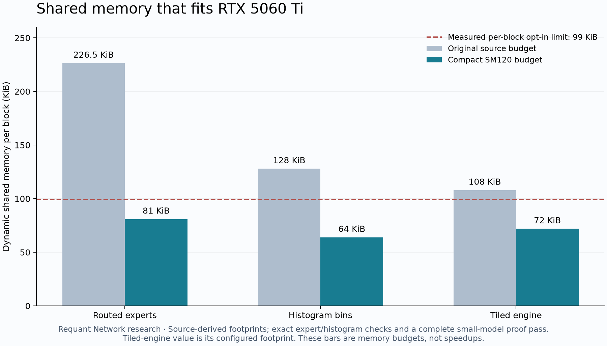

# Results

A research project by [Requant Network](https://requant.network).

## Complete native execution on consumer Blackwell

Five new GPU proofs are accepted by the original native CPU verifier, with exit status 0 and exact last line `YES`. They cover three independently randomized commitments, two small-model policy configurations and two additional independently seeded prompts. The synthetic weight construction is controlled; these are not three independently trained models.

Every accepted proof retains its ID, full native coverage statement, commitment assumptions, proof-of-work line and `result-v1`. Public configuration, verification key, request, response and proof are retained under [artifacts](artifacts). Proving keys, hidden staging data and rejected responses are excluded.

| Configuration / request | Commit, s | Prove, s | Verify, s | Proof bytes | Coverage r..e |
|---|---:|---:|---:|---:|---|
| roomy | 36.331 | 3.043 | 1.143 | 4,160,364 | 15..64 |
| roomy | 23.001 | 2.823 | 1.137 | 4,149,620 | 15..64 |
| gap | 35.424 | 3.210 | 1.137 | 4,147,180 | 63..64 |
| roomy / prompt 20261109 | reused | 2.920 | 1.149 | 4,149,884 | 63..64 |
| roomy / prompt 20261209 | reused | 3.270 | 1.149 | 4,154,500 | 63..64 |

These are standalone-process observations, not a thirty-sample fixed-input latency distribution. Commitment randomness and proof-of-work can affect runtime. The table permits a bounded compatibility comparison of both policies; it does not establish a statistically reliable performance ranking between them. Detailed values, IDs, memory fields and source-record links are in [proofs-summary.csv](results/proofs-summary.csv).

The two added prompts use r=63/e=64, so their proofs cover the next response token only. The configuration's original request has r=60/e=64, with its own detailed token coverage. Acceptance is always interpreted under the original policy and accounting statements rather than as an unqualified claim about every token in the prompt.

## Independent native controls

The retained public GPU artifacts are each checked by a separate whole native CPU verifier call. All five honest calls accept. All 35 altered calls reject: incorrect ID, changed request, changed response, changed proof, truncated proof, changed public key and changed leaf entry for each proof. The [raw control record](results/public-proof-controls.json) retains complete commands, exit codes, verdict lines and accepting metadata. A separate stored upstream proof also accepts, with five altered controls rejected.

Hosted CPU CI rebuilds the pinned verifier and rechecks the public GPU artifacts from their committed files. It does not run the CUDA prover or establish implementation-level formal correctness. Native acceptance retains the verifier's external assumptions and does not establish weight hiding.

## Device arithmetic and shared memory

Two expert input cohorts each contain 384 cases. All 3,258,112 output entries match the independent integer decoder with rational ties-to-even rounding. The largest configured dynamic allocation is 82,944 bytes, or 81 KiB, against the measured 101,376-byte opt-in limit. The compact path remains a fused WMMA expert kernel.

Two histogram cohorts each contain 114 cases, checking 12,500,052 exact counters in total, including nonzero initial counts, all 16-bit key windows and the original 15-bit range-table support. Dynamic histogram storage is at most 64 KiB. Packed-table initializer/accessor checks cover 1,179,648 entries across two cohorts; their minimal constant-visibility stub does not substitute for complete field arithmetic. Complete native acceptance provides the separate end-to-end check.

The figure is a memory-budget comparison, not a speedup plot. The original largest expert source footprint is 226.5 KiB; the compact footprint includes its output overlay. The tiled engine's configured budget falls from 108 to 72 KiB. Separate oversized forest-fusion paths use their existing exact generic implementation.

## Global memory qualification and failed baselines

An architecture flag plus the cuBLAS expert fallback builds but fails at an unconditional 128 KiB histogram opt-in. The memory-corrected version passes that point and then fails because of an unconditional 24 GiB engine reserve. Both failures remain documented. The consumer layer reserves 4 GiB for the engine while keeping the separate 2 GiB driver allowance, allocation checks and native pool-peak reporting.

The accepted runs qualify this reserve for the tested small configurations. The first key-generation engine-pool peak is 603,979,776 bytes, or 576 MiB; its entry-generation engine-pool peak is 301,989,888 bytes. Those are native pool high-water marks, not a measurement of total GPU peak allocation. Host RSS and slab sizes are separately retained in the logs and CSV.

The first compact draft also underestimated its WMMA output overlay. Its historical patch and independent footprint diagnostic remain in [compatibility-baselines.json](results/compatibility-baselines.json). The complete raw failed expert campaign and its earlier driver were not retained publicly; no timing or accuracy result is claimed from that draft. The corrected final tests and complete accepted cycles have full source bindings.

## Provenance and limits

The source pin is `9e2bdd8ff5bf9c62f18263d7dac189b0400b260c`. All four port layers retain Apache-2.0 attribution. Native CUDA is 13.3.73, a deviation from upstream's supported 13.2.86; the warning and 324-value compiler arithmetic sample remain active. Every native program runs as an ordinary user with the original private-path and allocation checks.

This is a bounded small-synthetic-model port. Larger models, arbitrary weight distributions, formal CUDA verification, hiding, adaptive attacks, service throughput and energy are unmeasured. See [Methods](METHODS.md), [related work](RELATED_WORK.md), [final conclusions](FINAL_REPORT.md), the [environment](results/environment.json) and the complete [protocol](RESEARCH.md).
